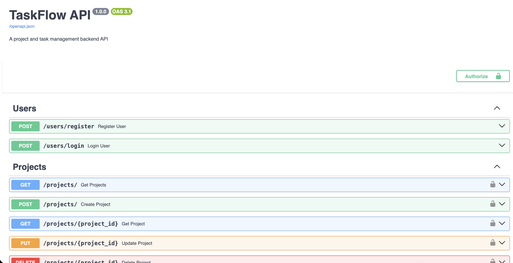

# TaskFlow API

TaskFlow API is a backend project and task management system built with FastAPI, PostgreSQL, SQLAlchemy, JWT authentication, Pytest, Docker, and GitHub Actions.

The project demonstrates backend software engineering concepts including authentication, database relationships, protected routes, CRUD operations, validation, automated testing, continuous integration, containerization, and cloud deployment.

## Live API

Swagger documentation:

https://taskflow-api-production-6594.up.railway.app/docs

Base API:

https://taskflow-api-production-6594.up.railway.app

GitHub Repository:

https://github.com/Raady223/taskflow-api

## Features

- User registration
- Secure password hashing with bcrypt
- User login
- JWT authentication
- Protected API routes
- Create, view, update, and delete projects
- Create, view, update, and delete tasks
- Tasks linked to projects
- User ownership protection
- Input validation with Pydantic
- PostgreSQL database
- SQLAlchemy ORM
- Automated API testing with Pytest
- Continuous Integration with GitHub Actions
- Docker and Docker Compose support
- Cloud deployment on Railway
- Interactive Swagger API documentation

## Technologies Used

- Python
- FastAPI
- PostgreSQL
- SQLAlchemy
- Pydantic
- JWT
- bcrypt
- Pytest
- GitHub Actions
- Docker
- Docker Compose
- Railway
- Uvicorn

## Project Structure

taskflow-api/
│
├── .github/
│   └── workflows/
│       └── ci.yml
│
├── app/
│   ├── routers/
│   │   ├── users.py
│   │   ├── projects.py
│   │   └── tasks.py
│   │
│   ├── auth.py
│   ├── database.py
│   ├── main.py
│   ├── models.py
│   └── schemas.py
│
├── tests/
│   └── test_api.py
│
├── images/
│   └── swagger-docs.png
│
├── .env.example
├── .gitignore
├── Dockerfile
├── docker-compose.yml
├── requirements.txt
└── README.md

## API Endpoints

The API contains 13 total endpoints, including 12 application endpoints for authentication, projects, and tasks.

### Users

POST /users/register  
POST /users/login

### Projects

POST /projects/  
GET /projects/  
GET /projects/{project_id}  
PUT /projects/{project_id}  
DELETE /projects/{project_id}

### Tasks

POST /tasks/project/{project_id}  
GET /tasks/project/{project_id}  
GET /tasks/{task_id}  
PUT /tasks/{task_id}  
DELETE /tasks/{task_id}

### Root

GET /

## Authentication

TaskFlow uses JWT-based authentication.

Users register with a username, email, and password. Passwords are hashed using bcrypt before being stored in PostgreSQL.

After login, the API generates a JWT access token. Protected routes require the token using the Bearer authentication scheme.

The API also performs ownership checks so authenticated users can only access and modify their own projects and tasks.

## Task Status Validation

Tasks support the following statuses:

todo  
in_progress  
done

Invalid task status values are automatically rejected using Pydantic validation.

## Automated Testing

The project uses Pytest and FastAPI TestClient for automated API testing.

The test suite covers:

- Root endpoint
- User registration
- User login
- JWT authentication
- Protected routes
- Project creation
- Project retrieval
- Task creation
- Task updates
- Task deletion
- Project deletion

Run the tests locally with:

python -m pytest

## Continuous Integration

GitHub Actions automatically runs the Pytest test suite whenever code is pushed to the main branch or a pull request is opened.

The workflow uses a PostgreSQL service container so the automated tests run against a real PostgreSQL database environment.

The CI status is displayed using the badge at the top of this README.

## Running With Docker

Build and start the FastAPI application and PostgreSQL database with:

docker compose up --build

Then open:

http://127.0.0.1:8000/docs

To stop the containers:

docker compose down

## Environment Variables

Create a `.env` file using `.env.example` as a template.

Required variables:

DATABASE_URL  
SECRET_KEY  
ACCESS_TOKEN_EXPIRE_MINUTES

The real `.env` file is excluded from Git through `.gitignore`.

## Cloud Deployment

The project is deployed publicly on Railway.

Railway hosts both:

- The FastAPI backend
- The PostgreSQL database

The production API can be accessed at:

https://taskflow-api-production-6594.up.railway.app

Swagger documentation is available at:

https://taskflow-api-production-6594.up.railway.app/docs

## API Documentation Preview

## What I Learned

Through this project, I practiced:

- Designing REST APIs with FastAPI
- Connecting Python applications to PostgreSQL
- Using SQLAlchemy ORM models and relationships
- Implementing JWT authentication
- Hashing and verifying passwords securely
- Protecting API routes
- Implementing ownership-based access control
- Performing CRUD operations
- Validating API input using Pydantic
- Writing automated tests with Pytest
- Using FastAPI TestClient
- Creating CI pipelines with GitHub Actions
- Running PostgreSQL inside GitHub Actions
- Containerizing applications with Docker
- Running multi-container applications with Docker Compose
- Managing application configuration with environment variables
- Deploying a backend API and PostgreSQL database to Railway
- Maintaining and deploying code through Git and GitHub